<!-- ═══════════════════════════ HEADER ═══════════════════════════ -->
<p align="center">
  
</p>

<p align="center">
  <a href="https://github.com/Amaridi">
    
  </a>
</p>

<p align="center">
  <a href="https://amaridi.github.io/Amaridi/"></a>
  <a href="https://linkedin.com/in/amaridi"></a>
  <a href="mailto:amar.idinarene@epita.fr"></a>
  
  <a href="https://github.com/Amaridi?tab=followers"></a>
</p>


<!-- ═══════════════════════════ ABOUT ═══════════════════════════ -->
##  About me

<table>
<tr>
<td width="58%" valign="top">

```cpp
struct Amar {
  std::string now      = "Full-Stack Engineer @ DIV Protocol";
  std::string school   = "EPITA — SCIA major (AI & Data Science), GPA 3.5";
  std::string exchange = "San Francisco State University (GPA 3.76)";
  std::string lead     = "Technical Lead @ GDG on Campus EPITA — 200+ members";
  std::string research = "LLM agent reliability — paper submitted to AAAI 2027";

  std::vector<std::string> focus = {
    "LLM agents, multi-agent systems & agent evaluation",
    "High-performance systems (C/C++, epoll, sendfile)",
    "Secure full-stack (TypeScript, React, NestJS, PostgreSQL)",
  };

  auto motto() const {
    return "Clarity, precision, and purpose.";
  }
};
```

</td>
<td width="42%" align="center" valign="middle">
  
</td>
</tr>
</table>


<!-- ═══════════════════════════ NOW ═══════════════════════════ -->
## 🔐 Right now

**Full-Stack Engineer @ DIV Protocol** · Paris · Sep 2026 → present
- Sovereign, zero-trust, end-to-end encrypted collaboration platform (calendar, mail, video), used by defense and drone companies.
- **475 pull requests** and **213,000+ lines** shipped to production across the stack (TypeScript, React, NestJS, PostgreSQL).
- Per-tenant HMAC service-to-service auth with anti-replay nonces, privileged-access auditing, field-level encryption.
- Multi-agent development: orchestrating Claude Code sub-agents with structured dev workflows.
- CI/CD and platform reliability, IMAP sync hardening (SSRF, malicious attachments), iCalendar/iMIP interop with Gmail, Outlook and Apple Calendar.

## 📄 Research

**Coverage-Driven User Intent Understanding** · with Cyprien Oudart · submitted to **AAAI 2027** (OpenReview, July 2026)

| Weighted intent coverage | |
|:--|--:|
| **ALI pipeline (ours)** | **89.0 %** |
| Claude Opus 4.8 | 58.4 % |

+30.6 pts · evaluated on 150 annotated prompts (κ = 0.749) and 3 real deployments: medical, software, finance (FinAgent).


<!-- ═══════════════════════════ PROJECTS ═══════════════════════════ -->
## 🧠 Featured Projects

<p align="center">
  
  
</p>
<p align="center">
  
  
</p>
<p align="center">
  
  
</p>

> 💡 **Academic integrity:** EPITA core-curriculum projects (42sh, Tiger Compiler, Custom Malloc) live in private repos to comply with anti-plagiarism rules. Happy to walk through the architecture and code live in an interview.


<!-- ═══════════════════════════ STACK ═══════════════════════════ -->
## ⚙️ Tech Stack

<p align="center">
  <a href="https://skillicons.dev">
    
  </a>
  <br/>
  <a href="https://skillicons.dev">
    
  </a>
</p>


<!-- ═══════════════════════════ STATS ═══════════════════════════ -->
## 📊 GitHub Stats

<p align="center">
  
  
</p>

<p align="center">
  
</p>

<p align="center">
  
</p>

<p align="center">
  
  
  
</p>

### 📈 Contribution activity

<p align="center">
  
</p>

### 🐍 Commit snake

<p align="center">
  <picture>
    <source media="(prefers-color-scheme: dark)" srcset="https://raw.githubusercontent.com/Amaridi/Amaridi/output/github-snake-dark.svg"/>
    <source media="(prefers-color-scheme: light)" srcset="https://raw.githubusercontent.com/Amaridi/Amaridi/output/github-snake.svg"/>
    
  </picture>
</p>


<!-- ═══════════════════════════ HIGHLIGHTS ═══════════════════════════ -->
## 🏅 Highlights

| | |
|:-:|:--|
| 📄 | Paper on LLM agent intent understanding **submitted to AAAI 2027** |
| 🏆 | **1st prize — App Technology Award** @ San Francisco State University (May 2025) |
| 🎓 | **3.76 GPA** @ SFSU · **3.5 GPA** @ EPITA |
| 📢 | **Technical Lead, GDG on Campus EPITA** — 200+ members, hackathon with HEC Paris (150 participants, $20k in prizes) |
| ☁️ | **MCP & A2A Hackathon, AWS Edition** — top 20 %, voice AI agent built in one day |
| 🌍 | Languages: French & Arabic (native), English (fluent) |

<!-- ═══════════════════════════ FOOTER ═══════════════════════════ -->
<p align="center">
  
</p>


